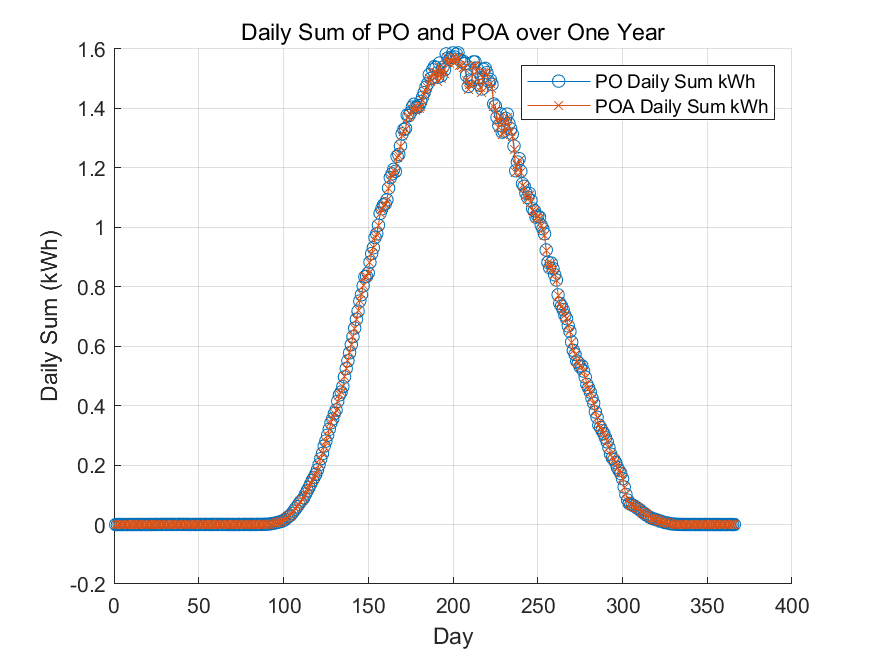
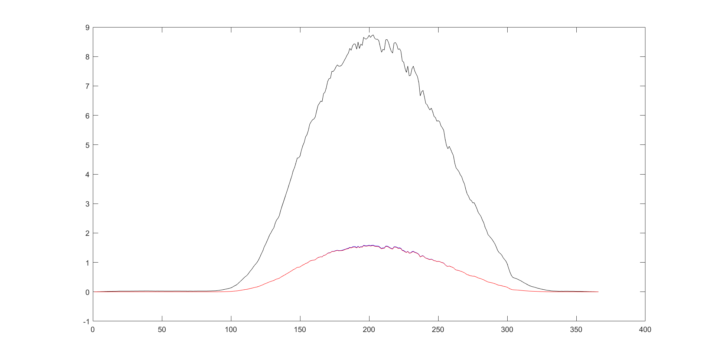
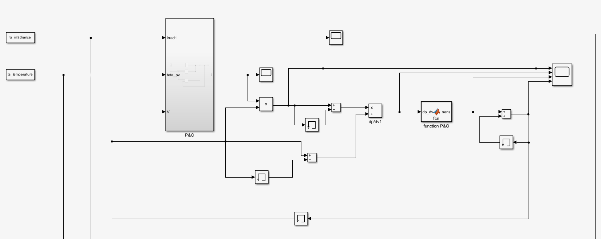

# MPPT direct — P&O et P&O amélioré

[Français](#français) · [中文](#中文)

Simulation MATLAB/Simulink du suivi du point de puissance maximale (MPPT
direct) d'un panneau photovoltaïque, sur une année complète de mesures réelles.
Projet de cours **BA04** à l'UTC (Université de Technologie de Compiègne),
juin 2024.



---

## Français

### Le sujet

Un panneau photovoltaïque ne fournit sa puissance maximale que pour un couple
tension/courant précis, qui se déplace avec l'éclairement et la température. Un
algorithme **MPPT** (*Maximum Power Point Tracking*) déplace en permanence le
point de fonctionnement pour rester au sommet de la caractéristique P(V).

On distingue deux familles :

- **MPPT direct** : on agit sur la tension (ou le rapport cyclique du
  convertisseur DC-DC) et on observe la puissance qui en résulte. C'est
  l'objet de ce dépôt.
- **MPPT indirect** : on estime la position du MPP à partir d'un modèle
  (tension de circuit ouvert, température, tables de correspondance) sans
  mesurer la puissance.

Le projet compare deux algorithmes directs :

| Algorithme | Principe | Point faible |
|---|---|---|
| **P&O** (*Perturb and Observe*) | On perturbe la tension d'un pas fixe ; si la puissance augmente, on continue dans le même sens, sinon on inverse. | Oscillation permanente autour du MPP, d'autant plus forte que le pas est grand. |
| **P&O amélioré (P&OA)** | Le pas est adapté en continu : grand loin du MPP pour converger vite, petit à l'approche du point optimal. | Réglage des gains, légèrement plus complexe. |

### Ma contribution

Projet mené à quatre — Nicolas Grand, Olivier Ondet, **Yicong Li**, Cenhao Liu —
et présenté dans `docs/BA04_rapport.pdf` sous le titre *Analyse des différentes
méthodes de MPPT directes*. Le rapport couvre quatre algorithmes (P&O et
conductance incrémentale à pas fixe, P&OA et logique floue à pas variable) et un
convertisseur SEPIC.

**Mon périmètre : l'algorithme P&O et son amélioration P&OA**, de la
modélisation Simulink à l'analyse énergétique annuelle présentée ici. Les
travaux du groupe sur les autres méthodes sont conservés dans
`archive/other_methods/`.

### Données et modèle

- **Mesures** : station STELLA de l'UTC, du 1er avril 2023 au 31 mars 2024,
  au pas d'une minute (1440 points par jour, 366 jours) — irradiation en W/m²,
  température ambiante et température de cellule en °C.
- **Panneau** : Kyocera **KC200GT**, modélisé sous Simulink pour le cours.
- **Modèles** : `models/pv_modeling_2_MPPT_POA.slx` (modèle principal) et
  `models/v19_POA.slx`. Les séries temporelles sont injectées dans l'espace de
  travail sous les noms attendus par les blocs *From Workspace*
  (`ts_irradiance`, `ts_temperature`).
- **Sorties** : puissance instantanée du P&O (`out.PO`) et du P&OA (`out.POA`),
  puis intégration en énergie journalière (kWh) et comparaison à l'énergie
  solaire incidente (kWh/m²) pour obtenir le rendement.



### Structure du dépôt

```
MPPT-direct/
├── README.md              ce document (FR + ZH)
├── src/                   code MATLAB
│   ├── setupProject.m     ajoute le code au chemin MATLAB
│   ├── projectRoot.m      racine du dépôt, indépendante de l'emplacement
│   ├── data/
│   │   ├── loadYearData.m charge une année de mesures
│   │   └── loadDayData.m  extrait une journée pour la simulation
│   ├── analysis/
│   │   ├── computeDailyEnergy.m    puissance -> énergie journalière
│   │   ├── computeEfficiency.m     rendement énergétique
│   │   └── plotDailyComparison.m   tracé annuel
│   ├── runSimulation.m    simule une journée
│   ├── runYearSimulation.m simule les 366 journées
│   └── runAnalysis.m      chaîne complète : CSVs + rendement + figure
├── models/                modèles Simulink (.slx)
├── data/
│   ├── raw/               mesures d'entrée (.xlsx)
│   └── processed/         résultats calculés (.csv)
├── results/               figures du rapport
├── docs/                  rapport, poster et présentation BA04
└── archive/               versions d'origine, autres méthodes, bibliographie
```

### Démarrage rapide

Prérequis : MATLAB R2022b ou plus récent, avec Simulink.

```matlab
cd('chemin/vers/MPPT-direct');
addpath('src');
setupProject();                 % ajoute src/ et ses sous-dossiers au chemin

% 1. Charger les mesures et extraire une journée
[tsT, tsG, dates] = loadYearData();
[tsTj, tsGj]      = loadDayData(tsT, tsG, dates, '2023-07-01');

% 2. Simuler cette journée
out = runSimulation('2023-07-01');

% 3. Calculer énergie, rendement et figure
runAnalysis(out, 'Irradiance', tsG.Data);
```

Pour reproduire les figures du rapport, il faut simuler l'année entière :

```matlab
out = runYearSimulation();                  % environ une minute par journée
runAnalysis(out, 'Irradiance', tsG.Data);
```

Les scripts écrivent dans `data/processed/` et `results/`, et n'utilisent que
des chemins relatifs à la racine : le dépôt peut être déplacé sans modification.

### Résultats

Sur l'année simulée, les deux algorithmes suivent la même enveloppe saisonnière :
l'énergie journalière culmine autour de **1,6 kWh** et s'annule sur les journées
sans éclairement exploitable. Les deux courbes se superposent presque, ce qui est
attendu sur des mesures à une minute : le P&O à pas fixe atteint déjà le MPP la
plupart du temps. L'apport du P&OA se lit surtout sur les transitoires
(changement brusque d'éclairement), où le pas adaptatif réduit l'oscillation
autour du point optimal.



### Remarques

- Le code a été restructuré et unifié après le cours (les paires
  `OutPO`/`OutPOA`, `EfficacePO`/`EfficacePOA`, `DataAnnee`/`DonneeAnnee` ne
  différaient que par le nom de la variable). Les versions d'origine sont dans
  `archive/legacy_scripts/`.
- L'analyse suppose un pas de calcul de 2 s dans le modèle ; c'est un paramètre
  de `runAnalysis`.
- Les modèles Simulink et les mesures appartiennent au cours BA04 ; merci de
  citer l'UTC et les auteurs du rapport si vous les réutilisez.

### Auteurs

Nicolas Grand, Olivier Ondet, Yicong Li, Cenhao Liu — BA04, UTC, juin 2024.

---

## 中文

### 课题背景

光伏板的输出功率只在特定的电压/电流组合下达到最大，而这个最大功率点会随
光照强度和温度不断漂移。**MPPT**（最大功率点跟踪）算法的作用就是持续移动
工作点，让组件始终工作在 P(V) 曲线的峰值附近。

MPPT 分为两类：

- **直接法（MPPT direct）**：直接调节电压（或 DC-DC 变换器的占空比），
  并观察由此产生的功率变化。本项目属于这一类。
- **间接法（MPPT indirect）**：依据开路电压、温度、查表等模型估算最大功率点
  的位置，不直接测量功率。

项目比较了两种直接法：

| 算法 | 原理 | 缺点 |
|---|---|---|
| **P&O（扰动观察法）** | 以固定步长扰动电压：功率上升则继续同向扰动，功率下降则反向。 | 稳态时在最大功率点附近持续振荡，步长越大振荡越明显。 |
| **改进型 P&O（P&OA）** | 步长自适应：远离最大功率点时用大步长快速逼近，接近时自动减小步长。 | 增益需要整定，实现稍复杂。 |

### 我负责的部分

这是四人小组课程项目：Nicolas Grand、Olivier Ondet、**Yicong Li**、
Cenhao Liu，成果见 `docs/BA04_rapport.pdf`（*Analyse des différentes méthodes
de MPPT directes*）。报告覆盖四种算法（固定步长的 P&O 与电导增量法、变步长的
P&OA 与模糊逻辑）以及 SEPIC 变换器。

**我负责 P&O 算法及其改进版 P&OA**：从 Simulink 建模到全年能量分析，即本
仓库的核心内容。组内其他方法的工作保留在 `archive/other_methods/` 中。

### 数据与模型

- **实测数据**：UTC 校区 STELLA 平台，2023 年 4 月 1 日至 2024 年 3 月 31 日，
  1 分钟采样（每天 1440 点，共 366 天）——辐照度（W/m²）、环境温度与电池
  温度（°C）。
- **组件**：Kyocera **KC200GT**，按 BA04 课程要求在 Simulink 中建模。
- **模型**：`models/pv_modeling_2_MPPT_POA.slx`（主模型）与
  `models/v19_POA.slx`。时间序列以 *From Workspace* 模块约定的名字
  （`ts_irradiance`、`ts_temperature`）注入工作区。
- **输出**：P&O 与 P&OA 的瞬时功率（`out.PO`、`out.POA`），积分得到日发电量
  （kWh），再与入射太阳能量（kWh/m²）相比得到效率。

### 目录结构

```
MPPT-direct/
├── README.md              本文件（法语 + 中文）
├── src/                   MATLAB 代码
│   ├── setupProject.m     将代码加入 MATLAB 搜索路径
│   ├── projectRoot.m      由文件位置推导仓库根目录
│   ├── data/
│   │   ├── loadYearData.m 载入一整年数据
│   │   └── loadDayData.m  提取某一天用于仿真
│   ├── analysis/
│   │   ├── computeDailyEnergy.m    功率 → 日发电量
│   │   ├── computeEfficiency.m     能量效率
│   │   └── plotDailyComparison.m   全年曲线
│   ├── runSimulation.m    单日仿真
│   ├── runYearSimulation.m 全年 366 天仿真
│   └── runAnalysis.m      完整流程：CSV + 效率 + 绘图
├── models/                Simulink 模型（.slx）
├── data/
│   ├── raw/               原始测量数据（.xlsx）
│   └── processed/         计算得到的 CSV
├── results/               报告插图
├── docs/                  BA04 报告、海报与答辩材料
└── archive/               原始版本、其他方法、参考文献
```

### 快速开始

环境要求：MATLAB R2022b 及以上，并安装 Simulink。

```matlab
cd('MPPT-direct 所在路径');
addpath('src');
setupProject();                 % 加入 src/ 及其子目录

% 1. 载入全年数据，取出某一天
[tsT, tsG, dates] = loadYearData();
[tsTj, tsGj]      = loadDayData(tsT, tsG, dates, '2023-07-01');

% 2. 仿真该日
out = runSimulation('2023-07-01');

% 3. 计算发电量、效率并出图
runAnalysis(out, 'Irradiance', tsG.Data);
```

若要复现报告中的全年曲线：

```matlab
out = runYearSimulation();                  % 约每天一分钟
runAnalysis(out, 'Irradiance', tsG.Data);
```

脚本只使用相对于仓库根目录的路径，因此仓库可以随意移动位置；结果分别写入
`data/processed/` 与 `results/`。

### 结果

在全年仿真中，两种算法呈现相同的季节变化轮廓：日发电量峰值约 **1.6 kWh**，
无有效光照的日子接近 0。两条曲线几乎重合——这在 1 分钟分辨率的实测数据上
是合理的：固定步长 P&O 大部分时间已经能跟上最大功率点。P&OA 的优势主要体现
在暂态过程（光照突变）中，自适应步长减小了在最大功率点附近的振荡。

### 说明

- 课程结束后对代码做了整理与去重：`OutPO`/`OutPOA`、`EfficacePO`/`EfficacePOA`、
  `DataAnnee`/`DonneeAnnee` 原先是仅变量名不同的重复脚本。原始版本保存在
  `archive/legacy_scripts/`。
- 分析默认取模型计算步长为 2 s，可通过 `runAnalysis` 的参数修改。
- Simulink 模型与实测数据属于 BA04 课程资料；如需引用，请注明 UTC 与报告作者。

### 作者

Nicolas Grand、Olivier Ondet、Yicong Li、Cenhao Liu — BA04，UTC，
2024 年 6 月。
